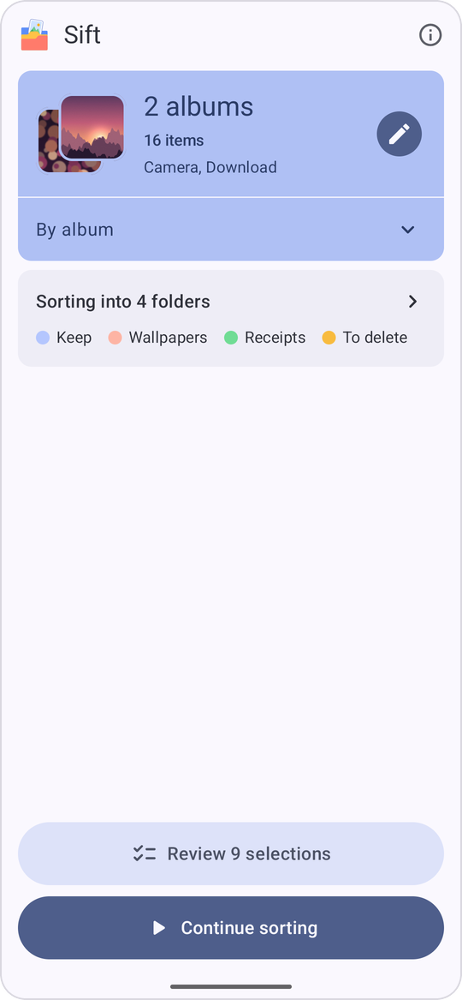
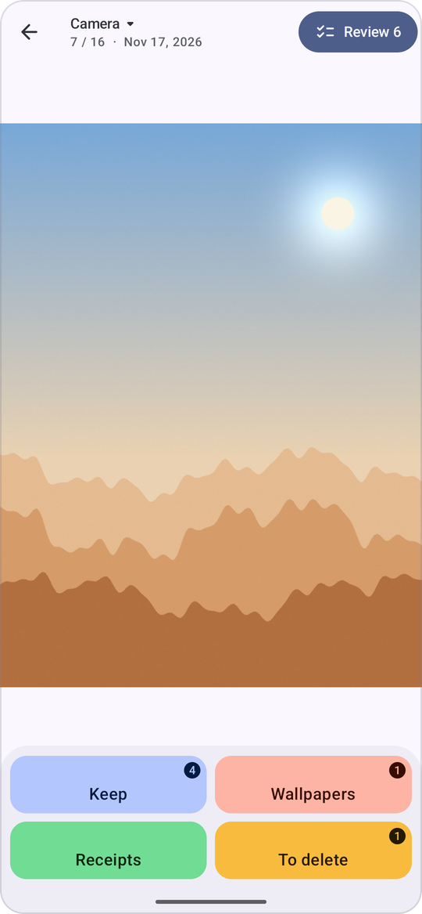
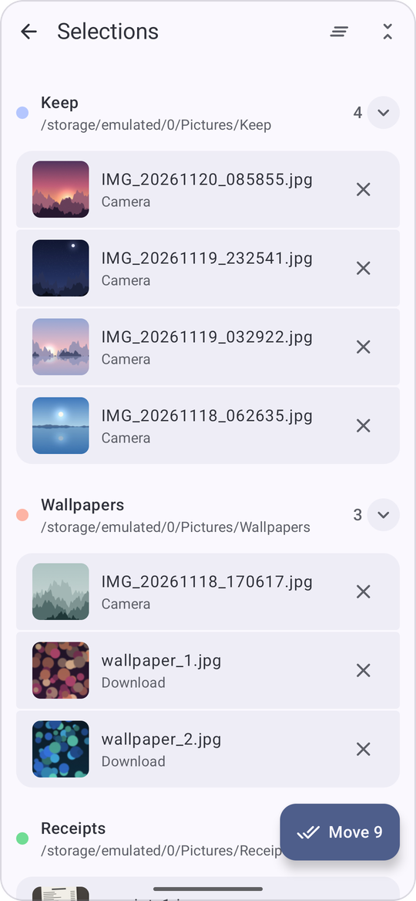
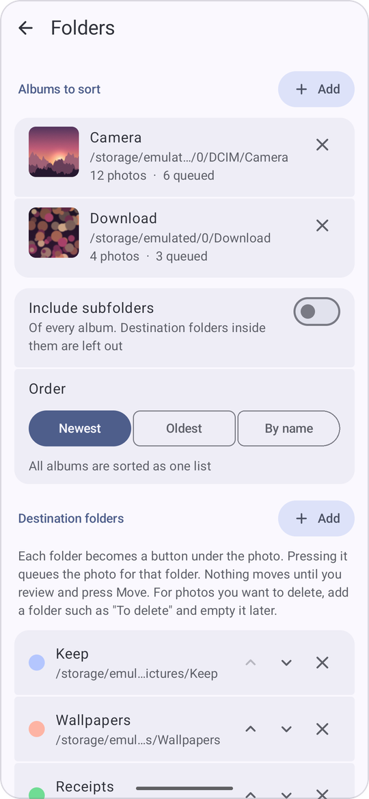
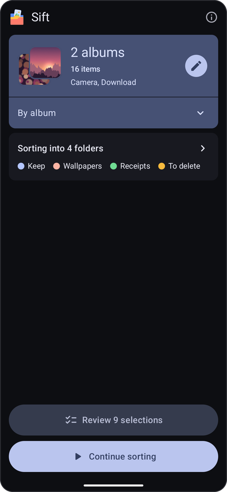
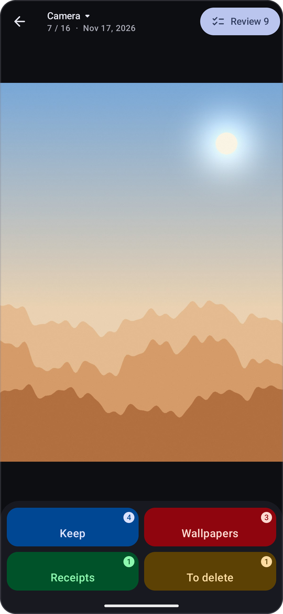
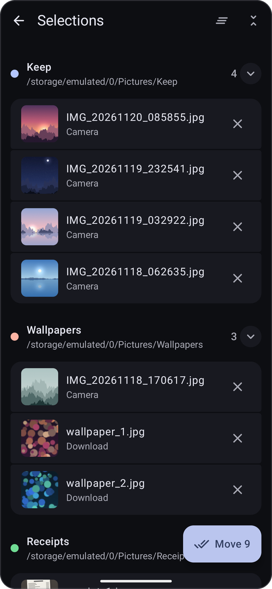

<p align="center">
  
</p>

<h1 align="center">Sift</h1>

<p align="center">
  Sort photos and videos into albums with a single tap
</p>

<p align="center">
  
  &nbsp;
  
  &nbsp;
  
  &nbsp;
  
</p>

Sift shows your photos one at a time, with a button under each one for every destination you sort into. Tap a destination and the next photo appears

Nothing moves while you sort. Your picks wait in a list you can check and change, and only Move touches the files. If a batch went wrong, Undo on Home puts it back

## How it works

1. **Pick your destinations.** Choose the albums to sort, such as Camera or Download, and the folders their photos can go to. Each destination becomes a coloured button
2. **Sort.** Tap a button to queue the photo for that destination and move on. Hold a button to send the photo to several destinations. Swipe past a photo to leave it where it is
3. **Review.** Selections lists every queued photo under its destination. Take one off, or open it full screen and swipe through the lot
4. **Move.** Sift moves the files in the background with a progress notification, so you can leave the app. Home then offers to undo the last batch

## Features

- Photos, videos and animated GIFs. Videos open muted and play full screen with zoom
- Pinch to zoom on any photo. While you sort, Ultra HDR photos show in HDR on screens that support it
- Several albums sorted as one list, newest first, oldest first or by name, with or without subfolders
- New destination folders go where gallery apps look for albums
- A move never overwrites a file, and never deletes a photo before its copy checks out. If Sift is closed halfway, it offers to finish the move or undo it
- Material 3 Expressive with your wallpaper colours on Android 12 and newer, a dark theme, right to left layouts and TalkBack labels

<p align="center">
  
  &nbsp;
  
  &nbsp;
  
</p>

## Privacy

Sift has no internet permission, so it can't send your photos or your sorting history anywhere. The queue and the undo history stay out of backups and device-to-device transfers, because they name files that exist only on this phone

## Permissions

| Permission | What Sift uses it for |
| --- | --- |
| Photos and videos | Showing your albums. Limited access would leave photos out, so Sift asks for all of them |
| Media management | Moving files without Android asking you to confirm every Move (Android 12 and newer) |
| Media location | Asked together with photo access, because Media management skips the Move confirmation only while Sift also holds it |
| Notifications | Showing a move's progress while Sift is in the background. Sift asks before the first Move |

Sift doesn't ask for All files access

## Requirements

Android 11 or newer

## Building

You need the Android SDK, from Android Studio or with `ANDROID_HOME` set. Gradle runs on JDK 25 and downloads it if your machine doesn't have it

```bash
git clone https://github.com/nikableh/sift.git
```

```bash
cd sift && ./gradlew assembleDebug
```

The APK lands in `app/build/outputs/apk/debug/`. Signed release APKs will be on the [Releases](https://github.com/nikableh/sift/releases/latest) page, built by GitHub Actions with a provenance attestation. [docs/RELEASING.md](docs/RELEASING.md) explains how to verify a download

## Feedback

Bugs and ideas go to [GitHub issues](https://github.com/nikableh/sift/issues)

## License

Sift is under the [MIT License](LICENSE). The libraries it uses are under the Apache License 2.0, and the app's About screen lists them
